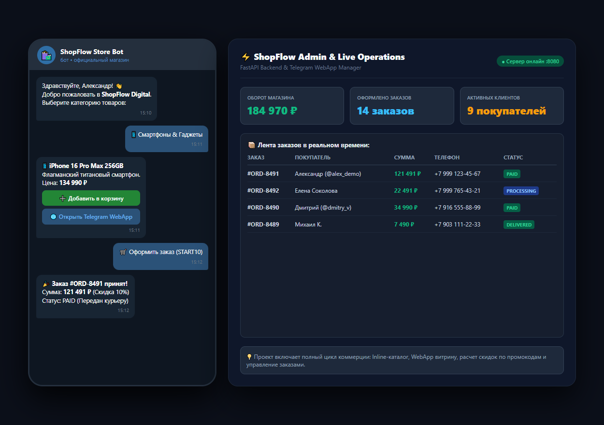

# ShopFlow Telegram Platform

Многомодульная платформа для Telegram E-Commerce (интернет-магазины, сервисы доставки, цифровые товары).

Объединяет классического Telegram-бота с Inline-каталогом, Telegram Mini App (WebApp) витрину, FSM-механизм оформления заказа, систему промокодов и веб-панель управления заказами на FastAPI.



## Архитектура проекта

```text
shopflow-telegram/
├── shopflow/
│   ├── config.py              # Настройки магазина, валюты и права админов
│   ├── database/
│   │   ├── connection.py      # Инициализация схемы SQLite и начальный посев товаров
│   │   ├── models.py          # Доменные структуры: User, Category, Product, Order, CartItem
│   │   └── crud.py            # Транзакционные операции с базой данных
│   ├── services/
│   │   └── cart_service.py    # Бизнес-логика корзины, скидок и промокодов
│   ├── bot/                   # Модули Telegram-бота
│   │   ├── keyboards/         # Inline и Reply клавиатуры
│   │   └── handlers/          # Обработчики каталога, корзины и пошагового чекаута
│   └── web_admin/             # Сервер веб-админки и WebApp
│       └── server.py          # FastAPI приложение с аналитикой и витриной
├── tests/                     # Unit-тесты сервиса корзины и промокодов
├── run_platform.py            # Одновременный запуск веб-портала и бота
└── run_bot.py                 # Запуск только Telegram-бота
```

## Возможности

1. **🛍️ Каталог товаров & Telegram WebApp:**
   - Двухуровневая структура: категории и карточки товаров с описанием, ценой и остатком.
   - Поддержка Telegram Mini App — клиенты могут открывать полноценную витрину прямо внутри мессенджера.

2. **🛒 Корзина & Промокоды:**
   - Добавление и удаление товаров, пересчет количества и сумм.
   - Валидация промокодов с расчетом процентной скидки (`START10`, `WELCOME20`).

3. **📦 Пошаговый чекаут (FSM):**
   - Сбор адреса доставки и контактного номера телефона.
   - Формирование уникального номера заказа (`ORD-XXXX`) и сохранение в SQLite.
   - Просмотр истории прошлых заказов со статусами доставки.

4. **💼 Панель управления менеджера (Web Admin):**
   - Доступна в браузере по адресу `http://localhost:8080`.
   - Живая лента заказов со сменой статусов (`PAID`, `DELIVERED`, `CANCELLED`).
   - Метрики выручки, среднего чека и топ самых продаваемых товаров.

## Быстрый старт

### 1. Установка зависимостей
```bash
git clone https://github.com/username/shopflow-telegram.git
cd shopflow-telegram
pip install -r requirements.txt
```

### 2. Запуск платформы (Веб-панель + Бот)
```bash
python run_platform.py
```
- Панель управления откроется по адресу: `http://localhost:8080`
- Витрина Telegram Mini App: `http://localhost:8080/webapp`

*Примечание: Если токен бота в переменной окружения `BOT_TOKEN` не задан, платформа работает в режиме эмулятора через веб-интерфейс без необходимости регистрировать бота в @BotFather.*

### 3. Запуск юнит-тестов
```bash
pytest tests/
```

